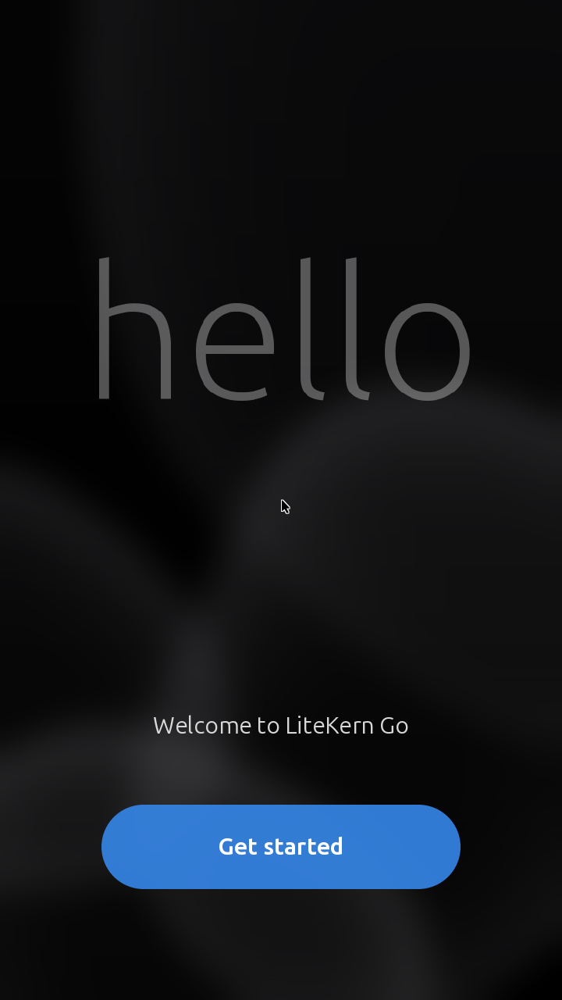
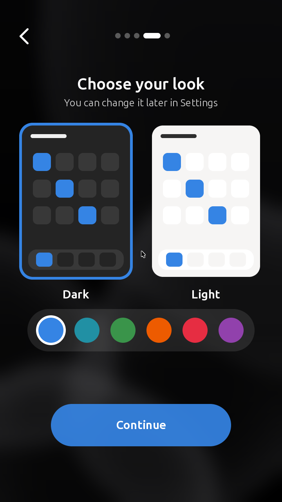
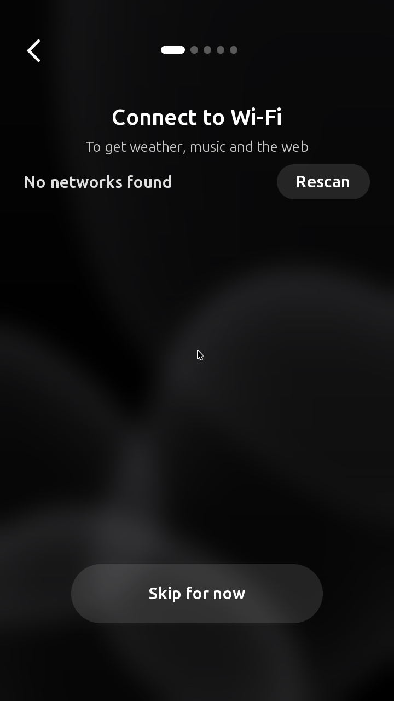

  

<h1 align="center">LiteKern Go</h1>

  A phone operating system on the Linux kernel with its own touch interface, for the Samsung Galaxy A5 (2015).

  
  
  

## What is it?

LiteKern Go is the phone sibling of [LiteKern X](https://github.com/lhuizach/LiteKern-X). The phone starts Linux directly (Samsung bootloader, lk2nd, Linux 6.12, then our own init), and then our own C shell, `lkx-shell`, draws the whole interface: home screen, lock screen, apps. There is no Android underneath and no launcher on top.

It was made for one person to use on one phone, so it is not a general release. Some parts are rough, and Android apps will not run.

## What it can do

- **Boot and first run:** a minimal boot animation, then on first run a setup that says hello in eight languages over the blurred wallpaper, joins Wi-Fi (with its own on-screen keyboard), sets the time zone and the look (dark or light, accent colour). No PIN is required.
- **Home screen:** icons anywhere on the grid, folders, widgets (date, battery, clock, music, weather) you can resize, several pages, an apps menu with Recent, and a lock screen with a big clock that turns the screen off after a few seconds.
- **Apps:** Files, Gallery, Camera (rear and front, autofocus), Browser (a real web engine, WPE WebKit, in a small sandbox), Music, Weather, Clock, Calculator, Task Manager, R3lay (a chat client), Blocksmith, and Settings.
- **Games:** Traffic Racer (landscape, steer by tilting the phone, real 3D on the phone's GPU, five places to drive in), Snake, Brickfit and Stackfall.
- **Hardware that works:** touch, display and brightness, Wi-Fi, sound (speaker, earpiece, headphones, microphone), both cameras, the accelerometer and the GPU. Calls and mobile data are not planned.

## Try it

The shell runs on a PC for development, at the phone's size, with the mouse as the touchscreen. You need Windows with WSL (Ubuntu):

1. Install [WSL](https://learn.microsoft.com/windows/wsl/install) with Ubuntu.
2. In this folder, run `wsl sudo bash tools/setup-wsl.sh` once.
3. `wsl make -f platform/Makefile run` starts it in a window. `LKX_SETUP=1` starts it with the first-run setup.

To put it on a phone you need the Galaxy A5 (SM-A500FU only) and the notes in [`CLAUDE.md`](CLAUDE.md) and [`phone/`](phone/). Never flash files for another model.

## Tests

- `bash tools/check-app.sh NAME`: builds one app and opens it (about a minute).
- `bash tests/linux/test-linux.sh`: the full suite (59 tests, about 10 minutes).

## For developers

- [`CLAUDE.md`](CLAUDE.md): the project's notes: the phone, the build, what works and what doesn't
- [Setup plan](docs/SETUP-PLAN.md): the first-run setup and what is planned for it
- [Making an app](docs/NEW-APP.md) and [the app list](docs/APPS.md): write your own app (the KERN86 model)
- [The browser plan](docs/BROWSER-PLAN.md)

LiteKern Go keeps LiteKern X's look, its app model (KERN86) and much of its shell code, reworked for touch and a portrait screen.
